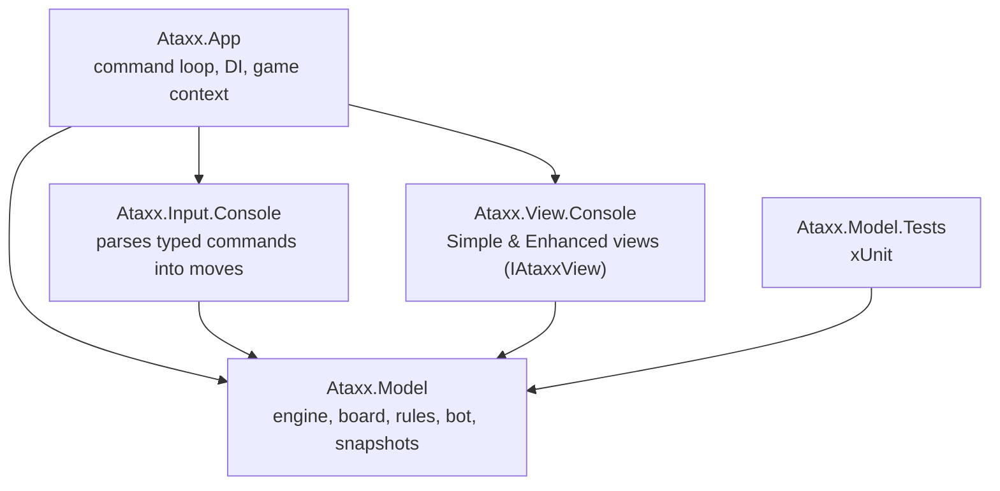

# Ataxx

A playable console version of **Ataxx**, a turn-based strategy board game, written in C# / .NET. The project is built around a clean **MVC/MVP** separation: the game rules, the display, the input parsing and the application wiring each live in their own project, so the model has no idea how the game is shown or controlled.

## The game

Ataxx is played on a 7×7 grid. On each turn a player either **clones** a piece to an adjacent cell or **jumps** it two cells away; every opponent piece next to the landing cell is then converted to the mover's colour. When no one can move, whoever controls more pieces wins.

- **Two game modes** — player vs player, and player vs a bot that plays random valid moves.
- **Three board layouts** (open, cross, centre-block) with walls, chosen at random each game.
- **Two views** that can be switched mid-game: a plain grid and an enhanced boxed-grid view.
- **Hints** (list all legal moves), **undo**, and a move history.

```
Ataxx - Simple View
-------------------
  A B C D E F G
1 X . . . . . O
2 . X . . . . .
3 . . O . X . .
...
> move D3
```

## Architecture

The solution is five projects. Dependencies point toward the model; the model depends on nothing else, which is what keeps the rules testable in isolation.



- **Ataxx.Model** — the heart of the game: `AtaxxEngine` enforces the rules (move validation, conversion, turn switching, win detection), `AtaxxBoard` holds the grid, `BoardFactory` builds the random layouts, `RandomBot` provides the PvE opponent, and `HintService` lists legal moves. Undo works by pushing a `GameSnapshot` before each move. An `AtaxxEngineWithEvents` variant raises events so a view can react without the model knowing about it.
- **Ataxx.View.Console** — two implementations of `IAtaxxView` (simple and enhanced), swappable at runtime.
- **Ataxx.Input.Console** — turns typed input like `move D3` into model moves, with a separate coordinate parser.
- **Ataxx.App** — the command loop. Each user action (`move`, `hint`, `undo`, `switch`, `start`, `exit`) is its own command class built by a `CommandFactory`, so adding a command doesn't touch the others.

The separation is deliberate enough that, as the brief put it, swapping the square board for a hex one would mostly touch the model and leave the views and commands alone.

## Build and run

Requires the [.NET 9 SDK](https://dotnet.microsoft.com/download).

```bash
cd AtaxxGame
dotnet run --project Ataxx.App
```

## Tests

```bash
cd AtaxxGame
dotnet test
```

The xUnit tests cover the core rules: valid clone and jump moves, rejection of illegal moves, piece conversion, turn switching and the initial game state.

## Layout

| Project | Responsibility |
| --- | --- |
| `Ataxx.Model` | Game rules, board, bot, hints, undo |
| `Ataxx.View.Console` | The two console views |
| `Ataxx.Input.Console` | Command and coordinate parsing |
| `Ataxx.App` | Command loop and composition |
| `Ataxx.Model.Tests` | xUnit tests for the model |

## License

[MIT](LICENSE)
